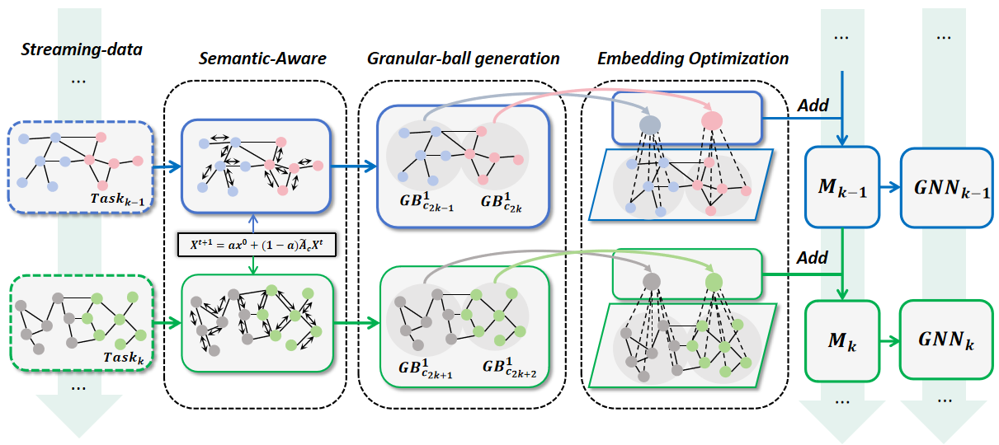

# GBReplay

[](LICENSE)
[](https://www.python.org/)
[](.github/workflows/syntax.yml)

Official implementation of **GBReplay: An Efficient Graph Continual Learning with Compact Granular-ball Replay for Node Classification**.

GBReplay builds a compact, edge-free replay memory for graph continual learning. It combines:

1. **Semantics-aware message propagation** to inject local graph context while reducing cross-class interference.
2. **Budgeted granular-ball generation** to select compact, high-purity replay prototypes.
3. **Embedding alignment optimization** to calibrate prototype geometry before rehearsal.



## Repository structure

```text
GBReplay/
├── backbones/                 # GCN classifier and auxiliary encoder
├── methods/                   # GBReplay and its replay utilities
├── experiments/               # Class-IL and Task-IL table runners
├── docs/                      # Reproduction and release notes
├── assets/                    # README assets
├── data_stream.py             # Continual task-stream construction
├── train.py                   # Unified training/evaluation entry point
├── utilities.py               # Dataset, backbone, and method factories
└── requirements.txt           # Non-PyTorch Python dependencies
```

## Installation

We recommend Python 3.10 in a fresh virtual environment:

```bash
python -m venv .venv
```

Activate it on Linux/macOS:

```bash
source .venv/bin/activate
```

Or on Windows PowerShell:

```powershell
.\.venv\Scripts\Activate.ps1
```

Install PyTorch for your CPU/CUDA platform, then install PyTorch Geometric and matching `torch-scatter`/`torch-sparse` wheels by following the [official PyG installation guide](https://pytorch-geometric.readthedocs.io/en/latest/install/installation.html). Finally, install the remaining dependencies:

```bash
pip install -r requirements.txt
```

Verify the core environment:

```bash
python -c "import torch, torch_geometric, torch_sparse, torch_scatter, ogb; print('environment OK')"
```

The release was checked with the following stack:

- Python 3.8.10
- PyTorch 2.4.1 + CUDA 12.1
- PyTorch Geometric 2.6.1
- torch-sparse 0.6.18
- torch-scatter 2.1.2
- OGB 1.3.6

Other compatible PyTorch/PyG combinations should also work.

## Datasets

The paper evaluates four public node-classification benchmarks:

| CLI name | Dataset | Classes | Tasks | Default per-task budget |
| --- | --- | ---: | ---: | ---: |
| `corafull` | CoraFull | 70 | 35 | 2 |
| `arxiv` | ogbn-arxiv | 40 | 20 | 26 |
| `reddit` | Reddit | 40 | 20 | 34 |
| `products` | ogbn-products | 46 | 23 | 319 |

Datasets are downloaded automatically by PyG/OGB and cached under `dataset/data/`. Each standard task contains two new classes and uses a 60/20/20 train/validation/test split.

## Quick start

Run GBReplay on CoraFull under Class-IL:

```bash
python train.py \
  --dataset-name corafull \
  --budget 2 \
  --cls-epoch 300 \
  --repeat 1 \
  --device cuda:0
```

For CPU execution, replace `--device cuda:0` with `--device cpu`. Large datasets are substantially slower on CPU.

Task-IL uses the same entry point:

```bash
python train.py --dataset-name corafull --budget 2 --IL taskIL --device cuda:0
```

## Reproducing the main tables

The two public runners reproduce the GBReplay rows in the Class-IL and Task-IL
main tables. They default to five repetitions, seed 1024, 300 epochs per task,
and two new classes per task.

| Experiment | Command |
| --- | --- |
| Class-IL main results | `python experiments/run_class_il.py` |
| Task-IL main results | `python experiments/run_task_il.py` |

See [docs/experiments.md](docs/experiments.md) for the table-to-script mapping and exact default configuration.

## Outputs

Generated artifacts are written under `results/`:

```text
results/<run>/
├── memory_bank/       # Serialized replay objects
├── performance/       # Per-task performance matrices
└── run.log            # Runner log
```

The reported metrics are:

- **AP**: average accuracy over tasks after the final task.
- **mAP**: mean AP across the task stream.
- **BWT/AF**: backward transfer (negative values indicate forgetting).

## Reproducibility notes

- Experiment runners use five repetitions by default.
- Cached task streams are keyed by dataset, classes per task, seed, and protocol.
- The code trains on `train_mask` and evaluates on `test_mask`.
- Raw historical task graphs are not used as replay data after their tasks have passed.
- The public implementation contains only the complete GBReplay method; ablation and comparison-method code is intentionally excluded.
- Large generated artifacts and datasets are intentionally excluded from Git.

## Citation

If this code is useful in your research, please cite the paper and this repository. A machine-readable citation is provided in [CITATION.cff](CITATION.cff).

```bibtex
@software{gbreplay2026,
  title  = {GBReplay: An Efficient Graph Continual Learning with Compact Granular-ball Replay for Node Classification},
  author = {Liu, Qun and Li, Hao and Liu, Maotao and He, Jing and Xie, Jiang},
  year   = {2026},
  url    = {https://github.com/duduovo/GBReplay}
}
```

## License

This project is released under the [MIT License](LICENSE).
